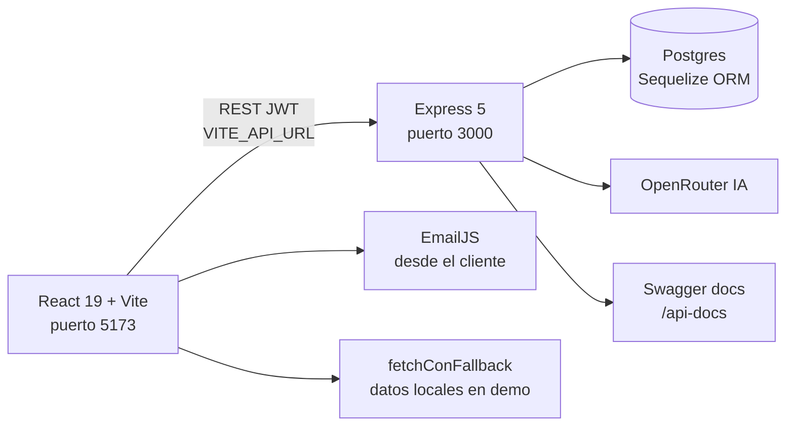

<div align="center">

# 📚 BibliotecaInteligente — BiblioTech Monorepo Full-Stack

**Sistema de gestión bibliotecaria con asistente IA, turnos de salas y panel admin. React 19 + Vite + Express 5 + Sequelize + Postgres.**

**Smart library management system with AI assistant, room bookings and admin panel. React 19 + Vite + Express + Sequelize + Postgres.**

[](https://reactjs.org/)
[](https://vitejs.dev/)
[](https://expressjs.com/)
[](https://sequelize.org/)
[](https://www.postgresql.org/)
[](https://biblioteca-inteligente-tau.vercel.app)
[](#-autor-contacto-y-licencia)

**[🚀 Demo en vivo](https://biblioteca-inteligente-tau.vercel.app) · [📦 Repo monorepo](https://github.com/FelipeDiazAimar/BibliotecaInteligente) · [🇬🇧 English version](README.en.md)**

> Monorepo que corre **backend + frontend juntos** con un solo comando. También existe spliteado en dos repos: [Backend](https://github.com/FelipeDiazAimar/Repositorio-Backend-BibliotecaInteligente) · [Frontend](https://github.com/FelipeDiazAimar/repositoriofrontendbibliotech) (demo: https://bibliotechjf.vercel.app).

</div>

> **English TL;DR:** BiblioTech is a smart library system: book catalog with covers, JWT auth with roles, AI assistant (OpenRouter) with voice input, study-room booking with guest invites, search history, and admin panels. This monorepo runs **both sides with zero DB** in demo mode (`DEMO_MODE` / `VITE_DEMO_MODE`, `fetchConFallback`, deterministic `[demo]` stubs). Real mode uses Postgres + OpenRouter. Full English docs in [README.en.md](README.en.md).

---

## 📑 Tabla de contenidos

1. [Qué es y qué problema resuelve](#-qué-es-y-qué-problema-resuelve)
2. [Demo en vivo + credenciales](#-demo-en-vivo--credenciales)
3. [Características](#-características)
4. [Arquitectura](#-arquitectura)
5. [Stack y librerías](#-stack-y-librerías)
6. [Estructura del monorepo](#-estructura-del-monorepo)
7. [Quick Start](#-quick-start)
8. [Instalación completa](#-instalación-completa)
9. [Variables de entorno](#-variables-de-entorno)
10. [Scripts](#-scripts)
11. [Guía de uso](#-guía-de-uso)
12. [API del backend](#-api-del-backend)
13. [Base de datos](#-base-de-datos)
14. [Deploy](#-deploy)
15. [Roadmap](#-roadmap)
16. [Troubleshooting](#-troubleshooting)
17. [Autor](#-autor-contacto-y-licencia)

---

## 💡 Qué es y qué problema resuelve

**BiblioTech** digitaliza una biblioteca real: antes todo era fichas, planillas y reservas por teléfono. Ahora hay catálogo online con portadas, login con roles, un **asistente IA** que responde consultas bibliográficas (con entrada por voz), **turnos de salas de estudio** con invitación de invitados, historial de búsquedas y paneles de usuario/admin.

| Antes | Ahora |
|---|---|
| Catálogo en papel/Excel | CRUD de libros con portadas (Multer), categorías, autores, editoriales |
| Reservas por teléfono | Turnos online con salas, horarios e invitados |
| Nadie orienta al lector | Asistente IA (OpenRouter + `jsonrepair`) + voz |
| Sin trazabilidad | Historial de búsquedas y préstamos por usuario |
| Demo imposible sin DB | **Modo demo total**: backend responde sin Postgres, frontend navega sin login |

---

## 🚀 Demo en vivo + credenciales

| Entorno | URL |
|---|---|
| 🌐 **Demo monorepo (Vercel)** | https://biblioteca-inteligente-tau.vercel.app |
| 🌐 Frontend split (Vercel) | https://bibliotechjf.vercel.app |
| ⚡ Backend split (Render) | https://repositorio-backend-bibliotecainteligente.onrender.com |
| 💻 Local | Frontend http://localhost:5173 · Backend http://localhost:3000 |

**Credenciales demo (frontend):** `demo@biblioteca.local` / `demo1234` (ver `Biblioteca-Inteligente-Frontend/src/lib/demo.js`: `DEMO_USER`, `DEMO_CREDENTIALS`, `demoDelay`, `fetchConFallback`). En modo demo las rutas protegidas (`/panel`, `/turnos`, `/admin`, `/admin-turnos`) renderizan sin pedir login.

**Backend sin DB:** con `DEMO_MODE=true` (o sin `.env`) el servidor igual inicia; `GET /api/health` → `{status: ok, demo: true}`; `GET /api/libros` → 5 libros de ejemplo; `POST /api/asistente/ask` → stub `[demo]` determinístico; el resto responde `503` JSON claro. Salud responde **aun sin Postgres**.

---

## ✨ Características

| Área | Feature |
|---|---|
| 📖 Catálogo | CRUD, portadas, filtros por categoría/autor/editorial, detalle |
| 🔐 Auth | Registro/login JWT, roles usuario/admin, rutas protegidas |
| 🤖 Asistente IA | Preguntas bibliográficas vía OpenRouter, entrada por voz, `jsonrepair` para respuestas robustas |
| 📅 Turnos | Reserva de salas, horarios, invitación de invitados, panel admin de turnos |
| 🔍 Historial | Búsquedas y actividad por usuario |
| 📊 Admin | Libros, usuarios, turnos, salas |
| 🎨 UX | MUI 7, dark/light mode, responsive, animaciones |
| 🧪 Demo | Stubs `[demo]` email/OpenRouter, seed idempotente, fallbacks sin DB |

---

## 🏗️ Arquitectura



**Modo demo:** `VITE_DEMO_MODE=true` → el front usa datos locales si el fetch falla. `DEMO_MODE=true` → el back usa seed en memoria + stubs. Ambos lados funcionan **sin Postgres ni claves**.

---

## 🛠️ Stack y librerías

**Raíz (orquestación):** `concurrently 9.1.2` para correr ambos lados juntos.

**Backend** (`biblioteca-inteligente-backend/package.json`):

| Paquete | Versión | Uso |
|---|---|---|
| `express` | `5.1.0` | API REST |
| `sequelize` + `pg` | `6.37.7 / 8.16.2` | ORM + driver Postgres |
| `jsonwebtoken` + `bcrypt` | `9.0.2 / 6.0.0` | Auth |
| `express-validator` | `7.2.1` | Validación |
| `multer` | `2.0.0` | Portadas |
| `axios` + `jsonrepair` | `1.9.0 / 3.12.0` | OpenRouter IA robusta |
| `swagger-jsdoc` + `swagger-ui-express` | `6.2.8 / 5.0.1` | Docs `/api-docs` |
| `cors`, `morgan`, `dotenv` | — | CORS, logs, env |
| `nodemon` (dev) | `3.1.10` | Reload |

**Frontend** (`Biblioteca-Inteligente-Frontend/package.json`):

| Paquete | Versión | Uso |
|---|---|---|
| `react`, `react-dom` | `19.1.0` | UI |
| `vite` | `6.3.5` (raíz: `7.0.0`) | Dev/build |
| `react-router-dom` | `7.6.1` | Rutas |
| `@mui/material`, `@mui/icons-material`, `@emotion/*` | `7.1.2 / 11.14.0` | Diseño |
| `@emailjs/browser` | `4.4.1` | Correos desde el cliente |

---

## 📁 Estructura del monorepo

```
BibliotecaInteligente/
├── package.json                    # dev / install-all / build-and-start (concurrently)
├── biblioteca-inteligente-backend/
│   ├── server.js + src/{config,models,controllers,routes,services,middlewares,app.js}
│   ├── runSeed.js                  # seed idempotente (no borra)
│   ├── test-db.js                  # diagnóstico solo-lectura
│   └── .env.example (DEMO_MODE, DB_*, JWT_SECRET, OPENROUTER_KEY, CORS_ORIGIN…)
└── Biblioteca-Inteligente-Frontend/
    ├── src/{components (AsistenteIA, Turnos, AdminTabs…),pages (Catalogo, BookDetail, AdminPanel…),lib/demo.js}
    ├── vite.config.js, index.html, public/
    └── .env.example (VITE_DEMO_MODE, VITE_API_URL)
```

Repos split equivalentes: `Repositorio-Backend-BibliotecaInteligente/biblioteca-inteligente-backend/` y `Repositorio-Frontend-BibliotecaInteligente/Biblioteca-Inteligente-Frontend/` (mismo código, con sus propios super READMEs).

---

## ⚡ Quick Start

```bash
git clone https://github.com/FelipeDiazAimar/BibliotecaInteligente.git
cd BibliotecaInteligente
npm run install-all   # instala deps de backend + frontend
npm run dev           # corre AMBOS juntos (backend :3000 + frontend :5173)
# 👉 http://localhost:5173 (demo@biblioteca.local / demo1234)
```

> Cero DB, cero claves: el demo anda de una.

---

## 🔧 Instalación completa

**Prerrequisitos:** Node 18+, npm 9+. Real: Postgres 12+ y clave OpenRouter.

```bash
npm run install-all
# solo diagnóstico backend (seguro, solo lectura):
node biblioteca-inteligente-backend/test-db.js
# seed demo idempotente:
node biblioteca-inteligente-backend/runSeed.js
npm run dev
```

**Por separado:**
```bash
# Backend
cd biblioteca-inteligente-backend
cp .env.example .env   # (Windows: copy)
npm install
node server.js         # o npm run dev (nodemon)
# Salud: GET http://localhost:3000/api/health

# Frontend
cd ../Biblioteca-Inteligente-Frontend
cp .env.example .env
npm install
npm run dev            # Vite :5173
npm run build && npm run preview  # prod local
```

**Modo real:** `DEMO_MODE=false` + Postgres (`DB_*` o `DATABASE_URL`) + `JWT_SECRET` largo + `OPENROUTER_KEY`; front con `VITE_DEMO_MODE=false` + `VITE_API_URL` apuntando al back. Producción: `npm run build-and-start`.

---

## 🔑 Variables de entorno

**Backend** (`.env.example` comentado línea por línea):

| Variable | Default / Requerida | Descripción |
|---|---|---|
| `DEMO_MODE` | `true` | `true` = seed + stubs sin DB; `false` = exige Postgres + claves |
| `PORT` / `NODE_ENV` | `3000 / development` | Puerto y entorno |
| `DB_HOST`, `DB_PORT`, `DB_NAME`, `DB_USER`, `DB_PASS` | `localhost:5432/biblioteca_dev/postgres/postgres` | Partes si no hay `DATABASE_URL` |
| `DATABASE_URL` | — | Prioritaria (SSL en prod) |
| `JWT_SECRET` | obligatorio en real | Sin ella en real: login/register 500. En demo usa secreto temporal |
| `OPENROUTER_KEY` | obligatorio en real | Sin ella en real: `POST /api/asistente/ask` falla; en demo stub `[demo]` |
| `EMAILJS_*` | reservadas | El envío se hace desde el front; back devuelve stub en demo |
| `CORS_ORIGIN` | `http://localhost:5173,…` | Orígenes permitidos |

**Frontend:**

| Variable | Descripción |
|---|---|
| `VITE_DEMO_MODE=true` | Sin backend: sesión simulada + `fetchConFallback` |
| `VITE_API_URL=http://localhost:3000` | Back real |

---

## 📜 Scripts

| Dónde | Comando | Qué hace |
|---|---|---|
| Raíz | `npm run dev` | Backend + frontend juntos (concurrently) |
| Raíz | `npm run install-all` | `npm install` en ambos |
| Raíz | `npm run build-and-start` | Build front + start ambos |
| Backend | `npm run dev` / `npm start` | nodemon / node server.js |
| Backend | `node test-db.js` / `node runSeed.js` | Diagnóstico / seed idempotente |
| Frontend | `npm run dev` / `build` / `preview` / `lint` / `vercel-build` | Vite estándar |

---

## 📖 Guía de uso

- **Lector:** catálogo → filtros → detalle → asistente IA (texto o voz) → reservar turno de sala → invitar acompañantes → ver historial en `/panel`.
- **Admin:** `/admin` libros/usuarios, `/admin-turnos` reservas y salas.
- **Docs API:** Swagger en `/api-docs` (back en real).

---

## 🔌 API del backend

Base `http://localhost:3000/api` (detalle completo en el README del repo Backend):

| Módulo | Ejemplos |
|---|---|
| Auth | `POST /auth/register`, `POST /auth/login`, `GET /auth/me` |
| Libros | `GET /api/libros`, `POST /api/libros` (admin, con portada), `PUT/DELETE /api/libros/:id` |
| Asistente | `POST /api/asistente/ask` (OpenRouter; stub `[demo]` en demo) |
| Turnos | `GET/POST /api/turnos`, invitados |
| Salas | `GET /api/salas` (admin CRUD) |
| Historial | `GET /api/historial` |
| Salud | `GET /api/health` (responde aun sin DB) |

---

## 🗄️ Base de datos

Postgres vía Sequelize: `users (roles)`, `libros`, `turnos`, `salas`, `invitados`, `historial_busquedas`. Seed idempotente con libros de ejemplo (sin binarios). En demo no se necesita; en real correr migraciones/sync y `runSeed.js`.

---

## ☁️ Deploy

- **Frontend (Vercel):** root = `Biblioteca-Inteligente-Frontend/`, build `vite build`. Vivo monorepo: https://biblioteca-inteligente-tau.vercel.app · split: https://bibliotechjf.vercel.app.
- **Backend (Render):** `render.yaml` en el repo split, start `node server.js`. Vivo: https://repositorio-backend-bibliotecainteligente.onrender.com. Setear `DATABASE_URL`, `JWT_SECRET`, `OPENROUTER_KEY`, `CORS_ORIGIN` (origen Vercel).

---

## 🗺️ Roadmap

- [x] Catálogo + auth JWT + IA + turnos + demo total
- [x] Split en repos front/back con deploys propios
- [ ] Préstamos con fechas y multas
- [ ] Notificaciones por email (EmailJS server)
- [ ] Tests (Vitest/Jest) + CI

---

## ❓ Troubleshooting

| Síntoma | Solución |
|---|---|
| Front en blanco sin back | Normal en demo si `VITE_DEMO_MODE=false` sin back → volver a `true` |
| `POST /api/asistente/ask` falla | Falta `OPENROUTER_KEY` en real (en demo responde stub) |
| login/register 500 | Falta `JWT_SECRET` en real |
| Todo `503` JSON | Back en demo sin DB: solo health/libros/asistente andan, el resto exige DB |
| CORS | Agregar origen Vite a `CORS_ORIGIN` |
| Puertos ocupados | Back `:3000`, front `:5173` (ver `server.js` / `vite.config.js`) |

---

## 👤 Autor, contacto y licencia

**Felipe Diaz Aimar** — Full-stack (React, Node, Postgres, IA).
- 💼 LinkedIn: https://www.linkedin.com/in/felipe-aimar/
- 📧 Email: felipediazaimar@gmail.com
- 🐙 GitHub: https://github.com/FelipeDiazAimar
- 🌐 Demo: https://biblioteca-inteligente-tau.vercel.app

Colaboración frontend split: [@JereMicheloud](https://github.com/JereMicheloud).

MIT. Ver `LICENSE` si aplica en el repo.

[(volver arriba)](#-bibliotecainteligente--bibliotech-monorepo-full-stack)

<details>
<summary><b>🇬🇧 English summary (full version in README.en.md)</b></summary>

BiblioTech monorepo runs backend (Express 5 + Sequelize, `:3000`) + frontend (React 19 + Vite, `:5173`) together via `concurrently`. Demo needs zero DB/keys (`demo@biblioteca.local` / `demo1234`). Real mode: Postgres + OpenRouter. Live: https://biblioteca-inteligente-tau.vercel.app.

</details>
